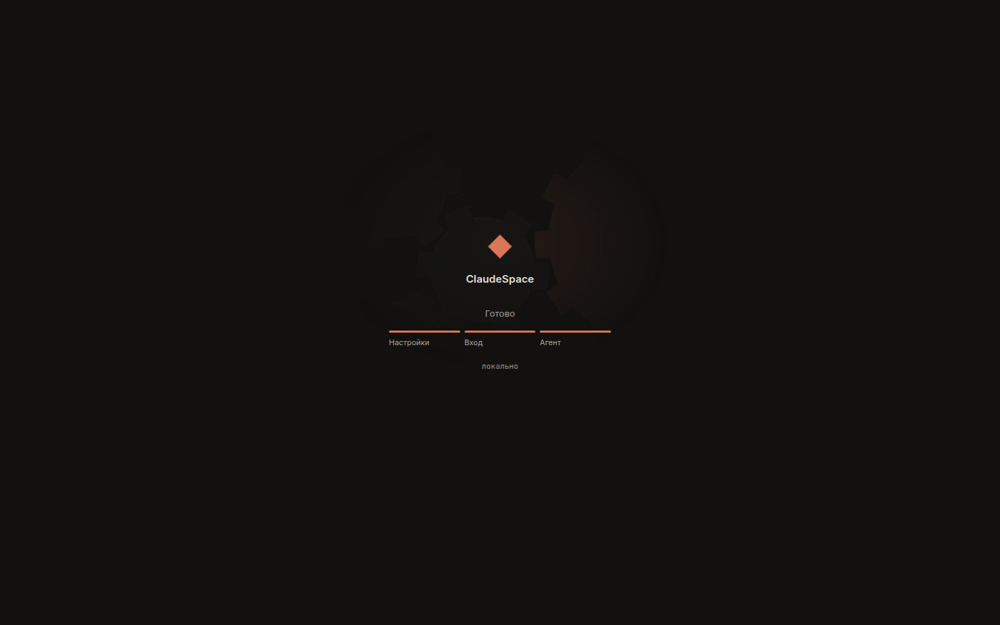
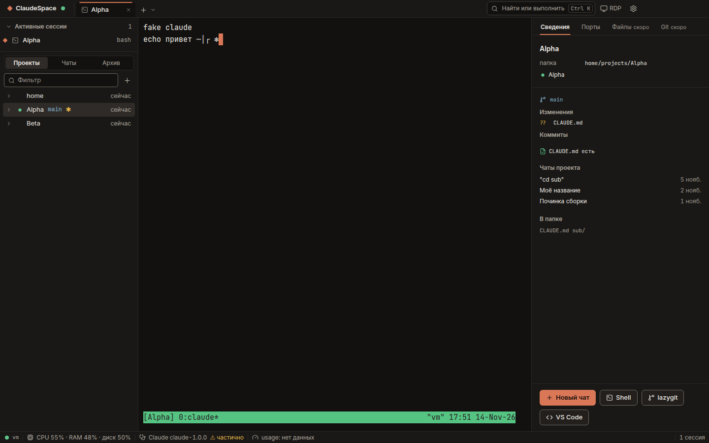
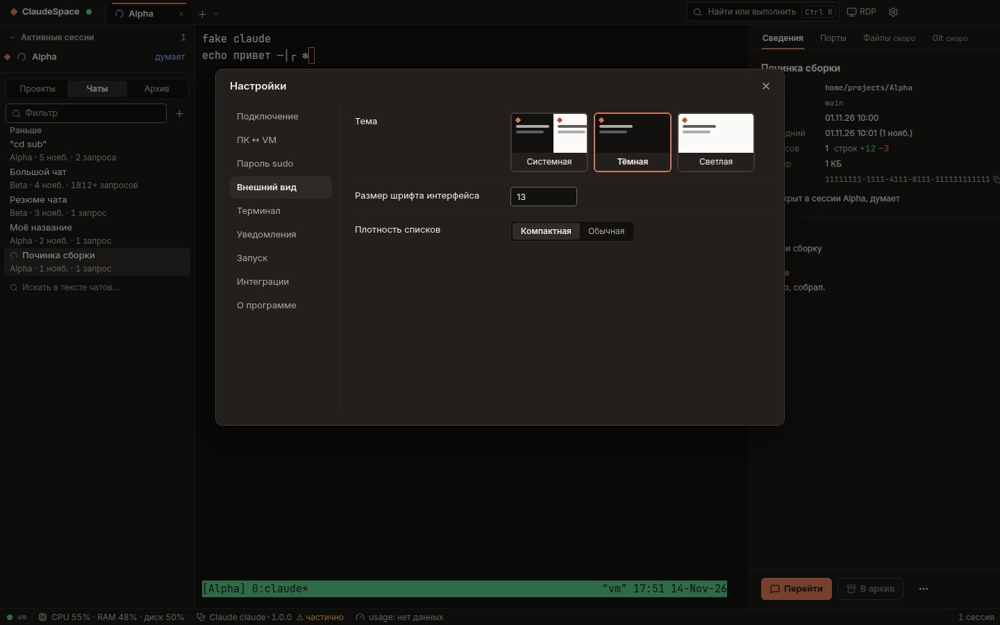

# ClaudeSpace

Настольное приложение для Windows, через которое удобно работать с [Claude Code](https://docs.anthropic.com/en/docs/claude-code),
запущенным на удалённой Linux-машине (VM) по SSH. Слева чаты, проекты и активные сессии, в центре вкладки терминала,
подключённые к сессиям tmux на VM. Ещё есть поиск по тексту чатов, уведомления «Claude ждёт ответа», трей,
проброс портов VM → ПК, окно для пароля `sudo` и кнопки RDP и VS Code Remote-SSH.



| Терминал | Настройки |
|---|---|
|  |  |

## Установка

1. Скачайте `ClaudeSpace-Setup-<версия>.exe` из [последнего релиза](../../releases/latest).
2. Запустите его. Права администратора не нужны: приложение ставится для текущего пользователя
   (`%LOCALAPPDATA%\Programs\ClaudeSpace`), создаются ярлыки на рабочем столе и в меню «Пуск».
3. Обновления приходят сами: приложение проверяет релизы при запуске и раз в 6 часов, скачивает новую версию
   в фоне и предлагает перезапуститься. Если отложить, обновление установится при выходе. Управление — в
   Настройках → «О программе».

**SmartScreen.** Сборки не подписаны сертификатом, поэтому при первом запуске установщика Windows может показать
«Система Windows защитила ваш компьютер». Нажмите «Подробнее» → «Выполнить в любом случае». Последующие
обновления ставятся без этого окна.

## Что нужно

- **На ПК**: Windows 10/11 x64, OpenSSH-клиент и запись `Host` в `%USERPROFILE%\.ssh\config` (по умолчанию `Host vm`)
  с ключом. Ключ берётся через ssh-agent Windows; если у ключа есть пароль, приложение спросит его. Пароль не сохраняется.
- **На VM** (Linux): `python3` ≥ 3.8, `tmux`, Claude Code (`claude` в `PATH` или в `~/.local/bin`). Приложение само
  ставит маленького агента в `~/.local/lib/claudespace/` (только stdlib Python) и больше ничего в системе не меняет.
- Необязательно: `lazygit`, `ccusage` (статистика использования), VS Code с Remote-SSH, свой PowerShell-скрипт для RDP
  (путь задаётся в Настройках → Интеграции).

## Разработка

Быстрый старт, тесты, архитектура и выпуск релиза описаны в [docs/DEV.md](docs/DEV.md). План: [docs/PLAN.md](docs/PLAN.md),
дизайн: [docs/DESIGN.md](docs/DESIGN.md).

```bash
npm ci
npm run dev        # на Linux-VM без sandbox: npm run dev:vm
npm test           # агент (python) + vitest
```

## Лицензия и благодарности

[MIT](LICENSE). Шрифты Inter и JetBrains Mono распространяются по SIL Open Font License 1.1
(тексты лицензий лежат в `resources/fonts/` и устанавливаются вместе с приложением).

На внешний вид и сценарии работы повлияли [opcode](https://github.com/winfunc/opcode) и
[simple-code-gui](https://github.com/DonutsDelivery/simple-code-gui) (см. [docs/INSPIRATION.md](docs/INSPIRATION.md)).
Оттуда взяты только идеи. Код не копировался: у этих проектов лицензии AGPL-3.0 и PolyForm Noncommercial, они
несовместимы с MIT.

Анимация шестерён на загрузочном экране основана на
[«fresh-panther-41»](https://github.com/uiverse-io/galaxy/blob/main/loaders/Nawsome_fresh-panther-41.html)
автора Nawsome с Uiverse.io (MIT, [uiverse-io/galaxy](https://github.com/uiverse-io/galaxy)): геометрия сохранена,
цвета и состояния переделаны (`src/renderer/splash/gearbox.css`).

ClaudeSpace — независимый проект, не связанный с Anthropic.
